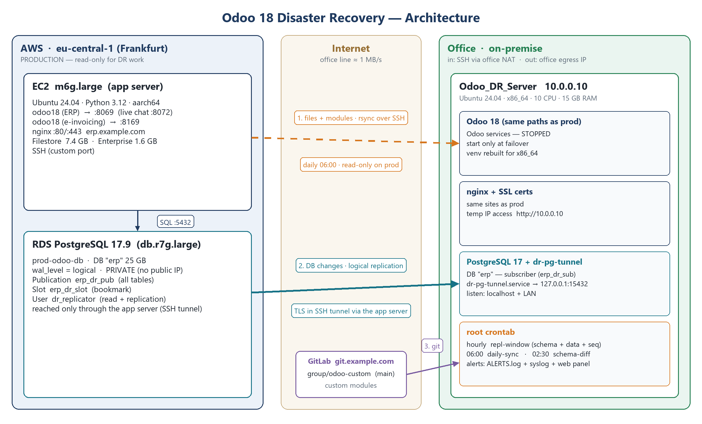
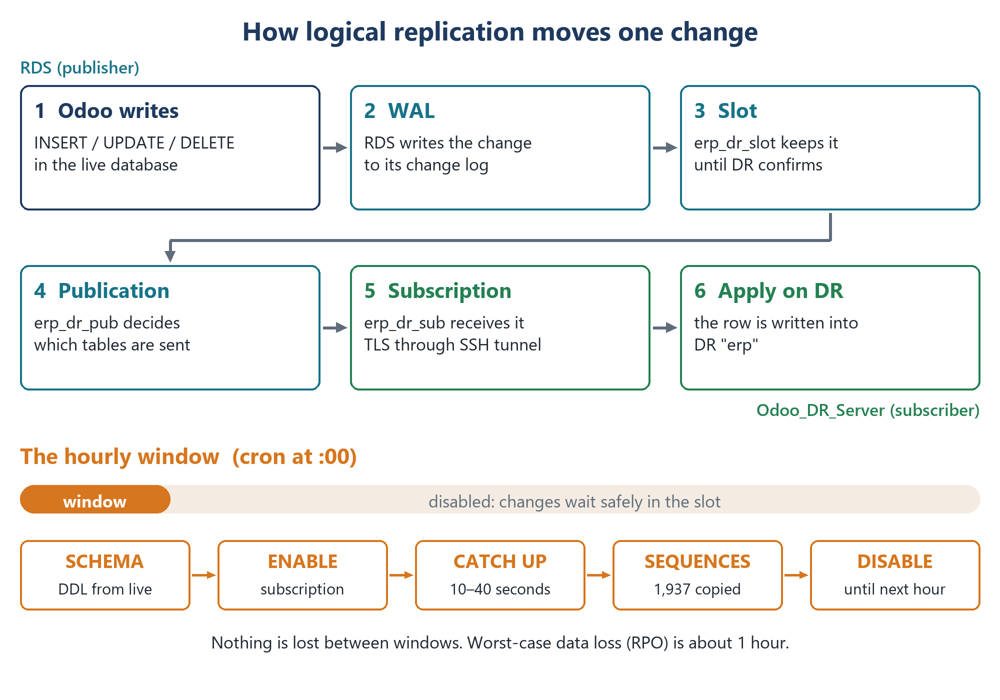

# 1. Architecture

## Goal

If the cloud site fails, the company keeps working on Odoo from an office server, losing at most about one hour of database work.

| Target | Value | How |
|---|---|---|
| RPO database | ≤ 1 hour | Logical replication, opened in an hourly window |
| RPO attachments and modules | ≤ 24 hours | rsync + git every day at 06:00 |
| RTO | ≈ 1 hour (target) | Software pre-installed; failover runbook |

## What is copied, and how

| What | Size (example) | Method | When |
|---|---|---|---|
| Database | 25 GB (≈13 GB data + indexes) | PostgreSQL logical replication, through an SSH tunnel (private RDS) | Hourly window |
| Database structure (DDL) | — | Automatic schema sync before each window | Hourly window |
| Sequences | ~1,900 | `setval()` copy after each window | Hourly window |
| Filestore (attachments) | 7.4 GB, ~28,500 files | rsync over SSH, **no delete** on DR | Daily 06:00 |
| Enterprise + Odoo core | 1.6 GB + 0.9 GB | rsync over SSH, exact mirror | Daily 06:00 |
| Custom modules | 40 MB | git fetch, commit = what production deployed | Daily 06:00 |
| Configs, services, nginx, certificates | small | copied once, refreshed by hand | On change |
| Python venv, wkhtmltopdf | ~400 MB | **rebuilt** on DR (production is ARM, DR is x86) | Once |

## Key ideas in plain words

| Term | What it means here |
|---|---|
| **WAL** | PostgreSQL's change log. Every change is written here first. RDS forces a WAL switch every 5 minutes (`archive_timeout`), which creates ~768 MB of WAL per hour even when nothing changes. |
| **wal_level = logical** | Makes the WAL detailed enough to rebuild row changes. On RDS: `rds.logical_replication = 1` (static → one reboot). |
| **Publication** | On the publisher: the list of tables to send. `FOR ALL TABLES` includes tables created later. |
| **Replication slot** | On the publisher: a bookmark. It keeps WAL until the subscriber confirms it. If DR is away, the slot grows; `max_slot_wal_keep_size` caps it. The kept WAL lives in `pg_wal`, **not** in the tables — a nightly `pg_dump` does not get bigger. |
| **Subscription** | On DR: connects to the publication, does the first copy, then applies changes. |
| **Table sync** | The first copy: workers copy each table (4 in parallel here). After that only changes flow. |
| **Sequences** | ID counters. **Not replicated** — synced by `dr-seq-sync.sh` at the end of every window. Between windows DR is a little behind; that is expected. |
| **DDL** | Structure changes (new table/column). **Not replicated** — `dr-schema-sync.sh` copies them from the publisher **before** each window lets data flow. |
| **SSH tunnel** | The production RDS has no public endpoint. `dr-pg-tunnel.service` on DR opens SSH to the production app server (inside the VPC) and forwards local port 15432 to RDS 5432. Every connection to the publisher uses `host=127.0.0.1 port=15432 sslmode=require`; TLS stays end to end. |
| **Replica identity** | How a row is found for UPDATE/DELETE (the primary key). A published table without a PK makes UPDATE/DELETE **fail on production**. Check before publishing. |
| **Hourly window** | Every hour: schema sync, then the subscription is enabled for 10–40 seconds, sequences are copied, and it is disabled again. Changes wait safely in the slot in between, so the slot grows ~0.8 GB per hour and drops back to ~0 after each window — by design. Continuous replication (RPO in seconds) is a one-line change. |

## Inventory template

Fill this in for your own environment and keep it with your runbooks (not in a public repo).

| Item | Example |
|---|---|
| Publisher | Amazon RDS for PostgreSQL 17, db.r7g.large, `<rds-endpoint>` |
| Production app server | EC2 m6g.large (ARM), Ubuntu 24.04, Python 3.12 |
| DR server | Ubuntu 24.04, x86_64, 10 CPU, 15 GB RAM, LAN `10.0.0.10` |
| Path to the publisher | private RDS: SSH tunnel via the app server (`config/dr-pg-tunnel.service`); public RDS: allow the office **egress** IP on 5432 |
| Office inbound | SSH via NAT port-forward to the DR server |
| Accounts | `odoo` (DB owner), `dr_replicator` (publisher, replication + read), `postgres` (DR, owns the subscription) |
| Paths | identical on production and DR: `/opt/odoo18`, enterprise addons, custom addons, filestore |
