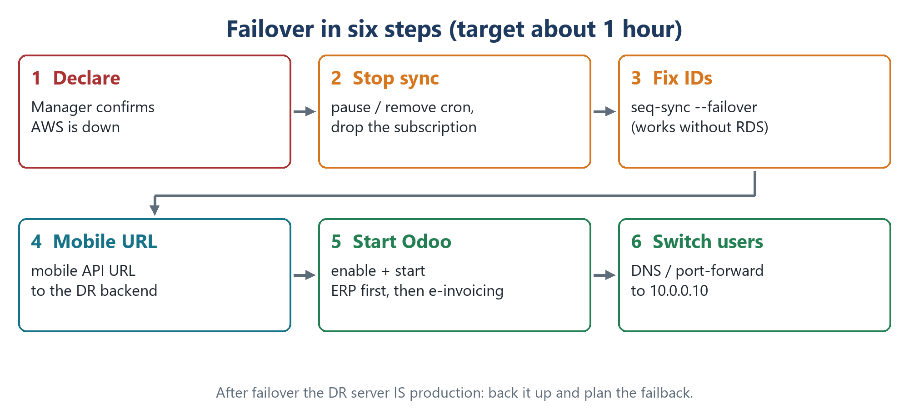

# 3. Operations and runbooks

## Daily checks

Start with `sudo tail -n 20 /var/log/odoo-dr/ALERTS.log`: every script writes its alerts there (and to syslog, tag `odoo-dr`). Then:

| Check | Command (DR) | Healthy |
|---|---|---|
| Replication windows | `sudo tail -n 12 /var/log/odoo-dr/dr-repl-window.log` | `window OK` every hour |
| Schema sync | `sudo tail -n 5 /var/log/odoo-dr/dr-schema-sync.log` | `differences: new tables=0, statements=0, alerts=0` (or changes applied, 0 alerts) |
| Nightly schema diff | `sudo tail -n 3 /var/log/odoo-dr/dr-schema-diff.log` | `IDENTICAL` |
| Morning file sync | `sudo tail -n 15 /var/log/odoo-dr/dr-daily-sync.log` | `daily sync OK` |
| Replication state | `sudo scripts/dr-repl-status.sh` | all tables ready, errors not rising, `enabled=false` between windows |
| Sequences | `grep sequences: /var/log/odoo-dr/dr-seq-sync.log \| tail -3` | `different=0 (vs copied snapshot)` after each window |
| Tunnel | `systemctl is-active dr-pg-tunnel` | `active` |
| Slot on publisher | `sql/04-cheat-sheet.sql` (slot query) | `wal_status = reserved`; ~0.8 GB per hour between windows, ~0 right after one |

> `dr-seq-sync.sh --check` compares with the publisher **as it is now**. Between windows DR is behind, so differences there are normal. Only the result right after a window counts.

**Pause / resume:** `echo "maintenance" | sudo tee /etc/odoo-dr/paused` makes every window skip (logged as `window skipped: replication paused`); `sudo rm /etc/odoo-dr/paused` resumes. The slot keeps the changes meanwhile. In production this flag is set from a small internal web panel. The panel reaches the DR server through an SSH key with a forced command (`command=…,from=…,restrict`), so it can only run fixed actions.

> **Never write to the DR database while replication runs.** It does not change production, but edits are silently overwritten, inserts cause duplicate-key errors that **stop** replication, and deletes leave DR missing data. Test on a copy (below).

---

## Runbook: failover



1. **Declare.** The decision owner confirms the cloud site is down and accepts losing up to the last hour.
2. **Stop the sync.** Create the pause flag, remove the hourly and nightly cron lines, then detach and drop the subscription.
3. **Fix the IDs.** `sudo scripts/dr-seq-sync.sh --failover` raises every owned sequence above the highest existing ID (works without the publisher).
4. **Integrations.** Point external integrations (e.g. a mobile backend URL stored in a table) at their DR endpoints.
5. **Start Odoo.** Enable and start the services, check the logs.
6. **Switch users.** DNS / port-forward 80/443 to the DR server.

```bash
sudo -u postgres psql -d erp -c "ALTER SUBSCRIPTION erp_dr_sub DISABLE;"
sudo -u postgres psql -d erp -c "ALTER SUBSCRIPTION erp_dr_sub SET (slot_name = NONE);"   # publisher unreachable
sudo -u postgres psql -d erp -c "DROP SUBSCRIPTION erp_dr_sub;"
sudo scripts/dr-seq-sync.sh --failover
sudo systemctl enable --now odoo18 && sudo tail -f /var/log/odoo/odoo18.log
curl -s -o /dev/null -w '%{http_code}\n' http://127.0.0.1:8069/web/login      # 200
```

After failover **the DR server is production**: back it up at once and every night, and plan the failback. Watch integrations that may repeat work done in the lost hour (e-invoicing submissions, emails).

### Failback (design and rehearse)

- Freeze DR Odoo, `pg_dump -Fc` the DR database and restore it to a new cloud instance — or replicate DR → cloud with the same method in reverse.
- rsync the filestore back, switch DNS, then rebuild DR replication from scratch.

---

## Module install / upgrade on production (automatic schema sync)

Module installs and upgrades add tables, columns, indexes and views. Logical replication does not copy structure, and one row with a column DR does not have **stops the apply worker** (*missing replicated column*). This happened for real during the production rollout, so the window now runs `scripts/dr-schema-sync.sh` **before** it enables the subscription. Developers deploy as usual, and DR follows at the next full hour.

| Change on the publisher | What the schema sync does |
|---|---|
| New table | `pg_dump --schema-only -t` of just that table, restored on DR in one transaction; the window then runs `REFRESH PUBLICATION WITH (copy_data = true)` |
| New / dropped column, default, NOT NULL, comment | Applied on DR (NOT NULL is retried while the new rows are still NULL) |
| Index, constraint (incl. FKs) | Dropped / created to match (FKs last) |
| Free-standing sequence (Odoo `ir_sequence_NNN` for a new journal) | Created on DR; extra ones dropped |
| View created / changed / dropped | Recreated from the publisher's definition (compared with a snapshot, because two servers can print the same view differently) |
| **Column type change** | **Alert only** |
| **Table on DR but not on the publisher** | **Alert only** — data is never dropped automatically |

**How it works:**
- A helper database (`dr_tools`) on DR reads both catalogs over `dblink` and generates ordered SQL (`sql/05-schema-sync-generator.sql`).
- It reads the catalogs only, takes no table locks and runs in about 10 s.
- The replicated database itself stays identical to production. The helper only stores the view snapshot.
- `scripts/dr-schema-diff.sh` runs nightly as a safety net. It does a full `pg_dump -s` of both sides and alerts on any difference.

**Tested with a drift test:** 10 deliberate breakages on DR were all repaired by the next window in 34 s, and the full diff then showed 0 differences. The breakages were a dropped table, column, index, FK, default, NOT NULL, sequence and view, an extra column and an extra index.

**When it raises an ALERT:**
1. Read it in `ALERTS.log` and the details in `dr-schema-sync.log`.
2. Pause replication (`/etc/odoo-dr/paused`).
3. Make DR match by hand, e.g. `ALTER TABLE x ALTER COLUMN y TYPE <type> USING y::<type>;`.
4. Run `dr-schema-sync.sh --check` until it reports `IN SYNC`, then resume.

**Still worth a heads-up:** a large module install can add many tables whose first copy takes longer than one window (`MAX_WAIT`, 45 min). Nothing breaks, and the next window continues. Watch out for services started with `-u <modules>`: they upgrade on every restart.

---

## Runbook: test Odoo on DR with a copy

Never start Odoo on the replica. Copy it between two windows, run Odoo on the copy with internet blocked, delete it.

```bash
sudo flock /run/lock/odoo-dr-repl-window.lock \
  sudo -u postgres psql -c 'CREATE DATABASE erp_test WITH TEMPLATE erp OWNER odoo STRATEGY FILE_COPY'
F=/opt/odoo18/.local/share/Odoo/filestore; sudo cp -al $F/erp $F/erp_test         # hard links, no extra space
sudo iptables -A OUTPUT -m owner --uid-owner odoo ! -d 127.0.0.0/8 -j REJECT       # no email, no APIs
# test config: db_name=erp_test, dbfilter=^erp_test$, workers=0, max_cron_threads=0
sudo -u odoo /opt/odoo18/venv/bin/python3.12 /opt/odoo18/odoo-bin neutralize -c /etc/odoo-test.conf -d erp_test
# ... test, then clean up
sudo iptables -D OUTPUT -m owner --uid-owner odoo ! -d 127.0.0.0/8 -j REJECT
sudo -u postgres psql -c 'DROP DATABASE erp_test'; sudo rm -rf $F/erp_test
```

---

## Runbook: rebuild replication from scratch

When the slot is lost (`wal_status = lost`), after a long outage, or after failback:

```bash
# remove the hourly cron line first
sudo -u postgres psql -d erp -c "DROP SUBSCRIPTION IF EXISTS erp_dr_sub;"     # also drops the slot on the publisher
sudo -u postgres psql -c 'DROP DATABASE erp'
# then build guide steps 3, 5 (tunnel active), 6, 8, 9, 10
```

## Runbook: rotate passwords

| Password | Change on | Then update |
|---|---|---|
| DR database owner | DR: `\password odoo` | `db_password` in the Odoo configs on DR |
| `dr_replicator` | publisher: `\password dr_replicator` | both `.pgpass` files on DR |
| Publisher master | cloud console | admin `.pgpass` on DR |

## Runbook: certificates

Certificates renew on production; DR holds a copy. Refresh it before expiry (or add it to the daily sync), then `sudo nginx -t && sudo systemctl reload nginx`.
